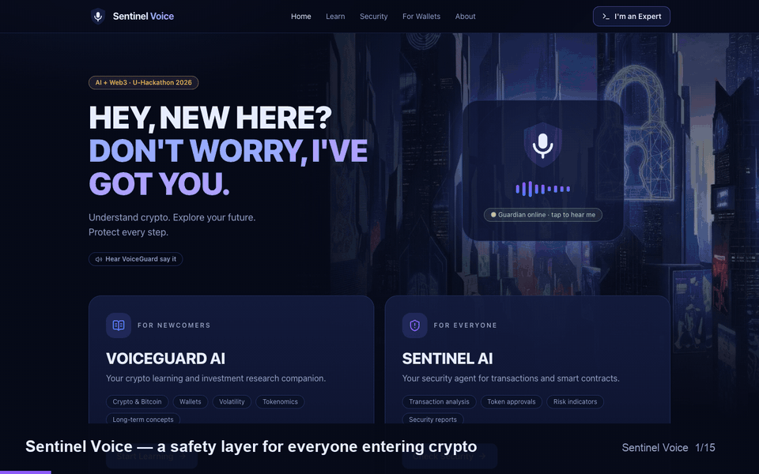

# Sentinel Voice

**Build your crypto future. Protect every step.**
An AI-powered safety layer for people entering crypto — built for U-Hackathon 2026 (FLOW Summit, Bangkok).

- **VoiceGuard AI** teaches newcomers by voice: how crypto works, how to buy safely, real price history, and a safety quiz.
- **Sentinel AI** checks before you sign: transactions, token supply risk, and payments proposed by AI agents.
- **Sentinel for Wallets** (B2B) tests wallets against real drainer techniques and gives a prioritised fix list.
- **Avalanche** seals every report's fingerprint on-chain, so nobody can quietly edit a warning.

The rules decide; the AI only explains. Every finding shows its rule, value and source.

## Demo



52-second walkthrough of every feature: [watch the MP4](docs/demo/sentinel-voice-demo.mp4) (silent — VoiceGuard's ElevenLabs voice plays live in the app).

## Run it

```bash
npm install
cp .env.example .env.local   # then add your keys (optional — see below)
npm run dev                  # http://localhost:3000
```

Open it in **Chrome** with the **Core** wallet extension (testnet mode) for the Avalanche features and the microphone.

| Variable | What for | Without it |
| --- | --- | --- |
| `ELEVENLABS_API_KEY` | VoiceGuard speech in/out | Falls back to the browser's built-in voice |
| `TOKENOMIST_API_KEY` | Live supply-risk data | Uses clearly labelled fictional sample tokens |
| `REPORT_REGISTRY_ADDRESS` | Override the Fuji registry | Uses `deployments/fuji.json` |

Keys stay on the server and in `.env.local`, which git ignores.

## Pages

| Page | What it does |
| --- | --- |
| `/` | Home; tap the guardian to hear VoiceGuard (ElevenLabs) |
| `/learn` | Ask VoiceGuard by text or voice; explains any Sentinel result |
| `/learn/start` | Buying guide, platform checklist, real price history, savings simulator |
| `/quiz` | Crypto safety quiz built with U-bot |
| `/security` | Transaction check in plain language |
| `/expert` | Evidence, JSON report, record and verify on Avalanche |
| `/supply` | Token supply risk from Tokenomist data |
| `/guard` | Agent Payment Guard for AI-agent payments (designed for U-topia) |
| `/business` | Drainer Readiness Audit for wallet companies (`?demo=1` for a demo report) |
| `/deploy` | One-time deploy of the Avalanche report registry with your wallet |

## Sponsors

| Sponsor | Role | Status |
| --- | --- | --- |
| Avalanche | `SentinelReportRegistry` on Fuji stores report fingerprints | Live |
| ElevenLabs | Scribe v2 speech-to-text, Flash v2.5 text-to-speech (cached) | Live |
| U-topia / U-bot | Agent Payment Guard for agentic payments; quiz generated with U-Code | Built with; payments API pending |
| Tokenomist | v5 unlock-events and allocations for supply risk | Code complete; sample data until API access is enabled |
| DTV Group | — | To be confirmed |

## How it works

- `src/lib/security/` — calldata decoder, deterministic rules, report format (`docs/report-schema.md`), SHA-256 fingerprint
- `src/lib/supply/`, `src/lib/tokenomist/` — supply-risk rules over Tokenomist data
- `src/lib/guard/` — payment policy engine for AI agents
- `src/lib/audit/` — drainer test pack, reference detector, controls and scoring
- `src/lib/voiceguard/` — reviewed answers and the investment-advice guardrail
- `src/lib/voice/` — ElevenLabs routes, shared player, browser fallbacks
- `src/lib/avalanche/` + `contracts/` — registry contract, wallet actions, verification

## Checks

```bash
npm run check:engine   # 61 tests: engine, VoiceGuard, supply, audit, payment guard
npm run typecheck
npm run lint
npm run build
```

Contract tests: start a local chain (`npx ganache@7.9.2 --port 8547 --chain.chainId 43113`), then `npm run check:contract`.

## Honest limits

- Demo transactions, the reputation list and sample tokens use fictional addresses and are labelled "Sample".
- Avalanche proves a report is unchanged since it was recorded — not that the analysis is correct.
- The wallet audit is a self-assessment and test pack, not a penetration test.
- Educational only — not financial advice.
